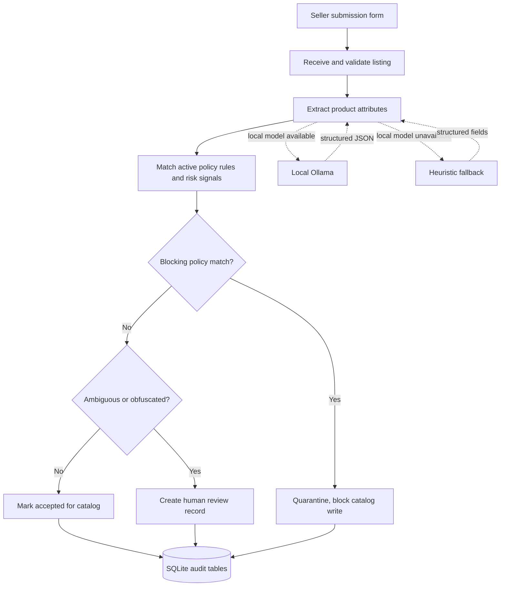
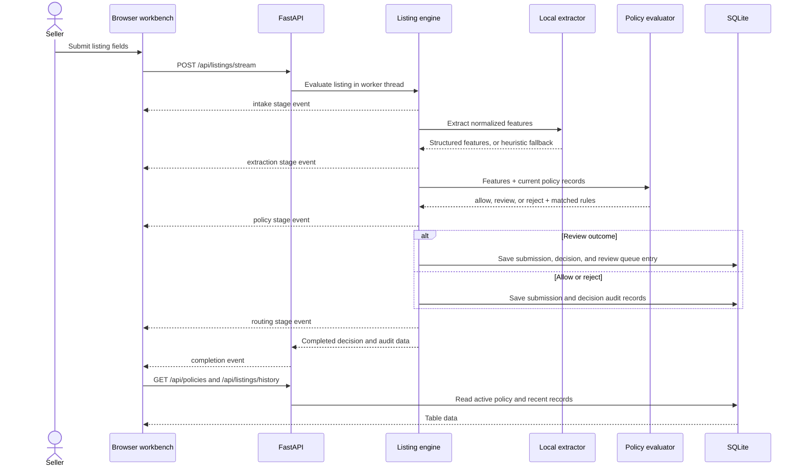

# TikTokshop Listing Safety Triage

A local, inspectable prototype for a marketplace listing moderation workflow. It is a learning project for policy operations, not a TikTok product and not a production enforcement service.

It basically lets you enter a form for product listing request as a business in order to enter the TikTokshop database. But in order to be listed, the request has to go through a safety procedure that decides whether or not, according to policy, the request should be approved. The engine consists of an LLM layer (in this case I use llama3.1 through ollama) for structured feature extraction, and a deterministic layer for final classification.

## Run it locally

Requirements: Python 3.11 or newer. A local Ollama server is optional. Without Ollama, the app logs a warning and uses a small deterministic heuristic extractor.

```powershell
cd C:\path\to\mso-tiktokshop-vape
py -m venv .venv
.\.venv\Scripts\Activate.ps1
pip install -r requirements.txt
uvicorn main:app --reload
```

Open <http://127.0.0.1:8000>.

To use Ollama, start the Ollama service and set its endpoint and model before starting the app:

```powershell
$env:OLLAMA_BASE_URL = "http://localhost:11434"
$env:OLLAMA_MODEL = "llama3.1"
uvicorn main:app --reload
```

The model is only asked to extract structured attributes. It does not choose the final allow, review, or reject outcome. If Ollama is unreachable, times out, or returns a response that fails schema validation, the application records a warning in the server log and uses the local heuristic extractor.

## Workflow



The UI diagram uses standard flowchart shapes: ovals for start and outcomes, rectangles for processing, and diamonds for the two yes/no decisions. These README diagrams use GitHub-supported Mermaid code fences. The browser streams receive, extraction, policy, and routing events as the server completes them.

## System Architecture

                            [ SHADY SELLER FORM ]
                                      │
                                      ▼
  ┌──────────────────────────────────────────────────────────────────────────────┐
  │ 1. WEB UI / LISTING INPUT PANEL                                             │
  │ - Collects title, description, category, price, vendor metadata             │
  │ - Allows submission of deceptive or borderline product listings              │
  │ - Shows the raw payload before processing                                    │
  └───────────────────────────────────────────────┬──────────────────────────────┘
                                                  │
                                                  ▼
  ┌──────────────────────────────────────────────────────────────────────────────┐
  │ 2. API GATEWAY / INTERCEPTION LAYER                                           │
  │ - Receives listing request                                                    │
  │ - Stores raw payload and timestamps                                           │
  │ - Triggers the moderation pipeline before persistence                         │
  └───────────────────────────────────────────────┬──────────────────────────────┘
                                                  │
                                                  ▼
  ┌──────────────────────────────────────────────────────────────────────────────┐
  │ 3. COGNITIVE EXTRACTION LAYER                                              │
  │ - Uses a local LLM to normalize seller wording into structured fields        │
  │ - Produces JSON with risk signals, ambiguity, and confidence                 │
  │ - Returns machine-readable extraction results                                 │
  └───────────────────────────────────────────────┬──────────────────────────────┘
                                                  │
                                                  ▼
  ┌──────────────────────────────────────────────────────────────────────────────┐
  │ 4. DETERMINISTIC POLICY ENFORCEMENT ENGINE                                  │
  │ - Evaluates extracted fields against active SQLite policy tables            │
  │ - Applies versioned rules and reason codes                                   │
  │ - Produces allow, reject, or review decision                                  │
  └───────────────────────────────────────────────┬──────────────────────────────┘
                                                  │
                  ┌───────────────────────────────┴───────────────────────────────┐
                  │                                                               │
                  ▼                                                               ▼
  ┌──────────────────────────────────────┐              ┌──────────────────────────────────────┐
  │ 5A. QUARANTINE / REJECTION FLOW      │              │ 5B. ALLOW / PERSIST FLOW              │
  │ - HTTP 422 response                  │              │ - Write allowed listing to SQLite    │
  │ - Review queue creation              │              │ - Emit decision audit log            │
  │ - Reason codes and risk metadata     │              │ - Render result in right panel       │
  └──────────────────────────────────────┘              └──────────────────────────────────────┘

### Request sequence



The current demo writes to an audit database, not to a real marketplace catalog. An `allow` result means the safety check passed and the submission status is recorded as accepted. There is no downstream catalog service in this prototype.

## Change the extraction prompt

Edit [`config/prompts/listing_extraction.txt`](config/prompts/listing_extraction.txt). The prompt is read for each evaluation, so a prompt edit takes effect on the next listing without a server restart.

Keep the `{listing_json}` placeholder. The extractor requires these exact fields:

- `normalized_product_type`: string
- `risk_signals`: array of strings
- `is_obfuscated_or_ambiguous`: boolean
- `confidence_score`: number from 0 to 1
- `reason_codes`: array of strings

The prompt explicitly says the model extracts evidence and must not make the moderation decision. `marketplace_app/extraction.py` validates the shape before policy evaluation.

## Change marketplace policies

Edit [`config/policies/active.json`](config/policies/active.json). It contains prohibited product types and named rules. Supported rule types are `normalized_product_type` and `risk_signal`.

Policy versions are immutable once imported. To publish a change:

1. Edit prohibited product entries or rule conditions.
2. Change `version_name`, for example from `v1` to `v2`.
3. Restart the app.

Startup imports the new version into SQLite, marks the previous version inactive, and keeps its records for history. Evaluations and the policy browser use only the active version. To roll back to a version that is still present in the database, set `version_name` to that version and restart. Do not edit an already imported version in place. A changed policy file with the same version name is intentionally not re-imported.

Decision behavior is in [`marketplace_app/policy.py`](marketplace_app/policy.py): a prohibited type or matching rule rejects; an otherwise-unmatched ambiguous listing goes to review; other listings are allowed. Changing policy data does not change this decision behavior. If the semantics must change, update that evaluator and its tests as well.

## Project layout

```text
config/
  policies/active.json             Initial policy bundle, versioned on import
  prompts/listing_extraction.txt   Editable local-model extraction prompt
marketplace_app/
  db.py                            SQLite schema, connections, queries, policy import
  engine.py                        One listing's end-to-end evaluation and audit writes
  extraction.py                    Extraction schema validation and local fallback
  model_client.py                  Prompt loading and optional Ollama request
  policy.py                        Deterministic feature-to-decision rules
static/
  app.js                           Workspace views, SSE handling, tables, inspector
  styles.css                       Workbench and static flowchart styles
templates/
  index.html                       Workbench structure and embedded flowchart icons
tests/
  test_config_files.py              Prompt and policy file contracts
  test_engine.py                    Streaming and audit-routing contract
  test_policy_and_extraction.py     Focused behavior tests
  test_policy_versions.py           Version activation and history
main.py                             FastAPI routes and streamed progress
marketplace_policy.db               Local SQLite data, ignored by Git
```

## Run the tests

```powershell
python -m unittest discover -s tests -v
```

The focused suite covers extraction validation, heuristic fallback behavior, policy outcomes, and editable configuration contracts.

## Data tables

- `policy_versions`: imported policy versions and effective dates.
- `policy_rules`: deterministic matching conditions and severity labels, which are informational in this prototype.
- `prohibited_products`: normalized product types blocked by policy.
- `listing_submissions`: raw listing and extracted feature snapshots.
- `moderation_decisions`: decision, policy version, matched rule IDs, and reason codes.
- `review_queue`: cases routed for human review.

The database file is local and excluded from version control. Do not put real seller information or credentials in this demo database.

## Known limits

- The included policy set and heuristic vocabulary are illustrative, not a complete marketplace policy.
- The model and heuristic extractor can miss adversarial or novel language. This prototype does not measure false-positive or false-negative rates.
- Policy management is file-driven for the demo. The web UI displays policy records but does not edit or publish them.
- Image, video, seller-history, and live catalog signals are not evaluated.
- The local audit database stores the submitted payload even when the listing is rejected. That audit write is separate from catalog acceptance.
